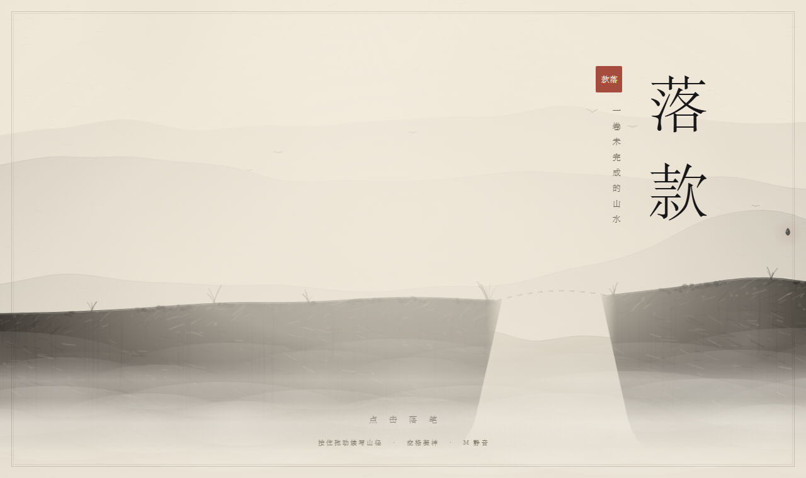

# 映河 · 五款单文件网页游戏

一个仓库收录五款可直接在浏览器里玩的单文件小游戏。效仿 Fable 5.2 的做法：**画面、音乐、音效全部由代码生成**，不依赖任何图片、音频、字体或第三方库；每款游戏就是一个 `index.html`，双击即可离线游玩，也可通过下方链接在线点击即玩。

本仓库已开启 GitHub Pages 静态托管，所有链接均可直接打开。

## 游戏一览

| # | 游戏 | 一句话 | 玩法 | 在线试玩 |
|---|------|--------|------|----------|
| 1 | 传灯 · THE PASSING LAMP | 一灯传一灯，七层塔次第醒来 | 拖动铜镜引导光路，点亮灯芯，让水墨从黑暗中显形 | [点击即玩](https://yukhughkui.github.io/fable-games/passing-lamp/) |
| 2 | 鹤渡 · AZURE CRANE | 御风而行，过千山而不留痕 | 点击振翅穿过石门、收集灵气，在晨昏流转的青绿山水间飞行 | [点击即玩](https://yukhughkui.github.io/fable-games/azure-crane/) |
| 3 | 星弦 · ASTRAL CHORD | 七弦张于星海，拨之令其开花 | 用 A S D F J K L 或点击拨动七弦，在星子滑到共鸣环时命中 | [点击即玩](https://yukhughkui.github.io/fable-games/astral-chord/) |
| 4 | 星槎 · LUMEN DRIFT | 以光为桨，渡墨海无涯 | 引舟借玄涡引力甩速，拾光蓄能放冲击波，在星潮中穿行 | [点击即玩](https://yukhughkui.github.io/fable-games/lumen-drift/) |
| 5 | 落款 · 一卷未完成的山水 | 你是那滴赶在淡墨之前落笔的墨 | 用有限的墨量续写脚下山径，走完五卷并为长卷落下印章 | [点击即玩](https://yukhughkui.github.io/fable-games/luokuan/) |

## 开始页面

每款游戏的开始页面（标题页）如下，点击进入即为游戏本体：

### 1. 传灯 · THE PASSING LAMP


实时光线追迹 + 东方夜色水墨。七层高塔沉睡于黑暗，拖动铜镜把一束光引向灯芯，被光照到的那一层，水墨才从黑暗中显形，并浮现一句诗。所有镜面角度由光路反推生成，保证每层有解；音效由 Web Audio 合成。

- 入口：[passing-lamp/index.html](passing-lamp/index.html) · [在线试玩](https://yukhughkui.github.io/fable-games/passing-lamp/)
- 操作：拖动鼠标 / 触屏旋转铜镜，蓄光点亮灯芯

### 2. 鹤渡 · AZURE CRANE


青绿山水御风飞行。晨、昼、暮、夜循环调色，四层远山视差，一只丹顶鹤穿过石门、收集灵气。难度随距离递增，带最高分记录与静音开关。

- 入口：[azure-crane/index.html](azure-crane/index.html) · [在线试玩](https://yukhughkui.github.io/fable-games/azure-crane/)
- 操作：点击 / 空格振翅，`P` 暂停

### 3. 星弦 · ASTRAL CHORD


深空紫黑底 + 七色极光放射星弦。七根弦张于星海，星子沿弦滑向共鸣环，在恰当时机拨弦命中。六个乐章 BPM 84→132，含连击、和谐度、评级结算与天籁满能全屏绽放。

- 入口：[astral-chord/index.html](astral-chord/index.html) · [在线试玩](https://yukhughkui.github.io/fable-games/astral-chord/)
- 操作：`A S D F J K L` 或点击拨弦，精确判定 PERFECT / GOOD

### 4. 星槎 · LUMEN DRIFT


墨海深空 + 引力弹弓光轨。驾驶一叶星槎借玄涡的引力甩速，拾取星屑蓄「燎原」，满能释放冲击波横扫玄涡墨鸦。逐潮演进的配色与难度，带连击加成与最高分。

- 入口：[lumen-drift/index.html](lumen-drift/index.html) · [在线试玩](https://yukhughkui.github.io/fable-games/lumen-drift/)
- 操作：鼠标 / 触屏 / `WASD` 引舟，空格 / 点击放光爆，`P` 暂停，`M` 静音

### 5. 落款 · 一卷未完成的山水



程序化生成的淡墨水卷。你是一滴墨，赶在淡墨底稿漫过之前用毛笔续写脚下的山径；墨量有限，写下的笔迹永久留在画上。走完溪、石、风、雾、归五卷，终章自动回放并落下「落款」朱印，还可将长卷导出为图片。

- 入口：[luokuan/index.html](luokuan/index.html) · [在线试玩](https://yukhughkui.github.io/fable-games/luokuan/)
- 操作：按住拖动绘制山径，拾取墨点补充墨量，`M` 静音

## 目录结构

```
fable-games/
├── index.html              # 游戏总入口（导航页）
├── README.md
├── passing-lamp/index.html # 传灯
├── azure-crane/index.html  # 鹤渡
├── astral-chord/index.html # 星弦
├── lumen-drift/index.html  # 星槎
├── luokuan/index.html      # 落款
└── screenshots/            # 各游戏开始页面截图
```

## 本地运行

每款游戏都是自包含的单文件，直接用浏览器打开对应 `index.html` 即可，无需安装依赖或联网。也可以在本仓库目录启动任意静态服务器，例如：

```bash
python -m http.server 8000
```

然后访问 `http://localhost:8000/` 进入导航页。

## 静态托管

通过 GitHub Pages 部署，仓库地址：`https://github.com/yukhughkui/fable-games`，站点地址：`https://yukhughkui.github.io/fable-games/`。

---

导演 / 渲染 / 作曲：映河、云渡禅穹 · 2026
