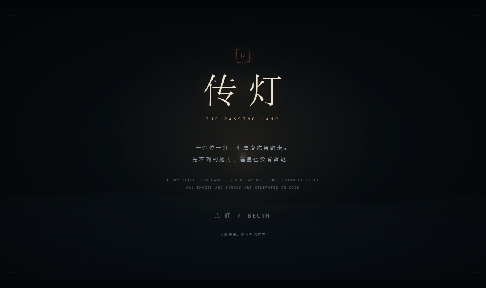
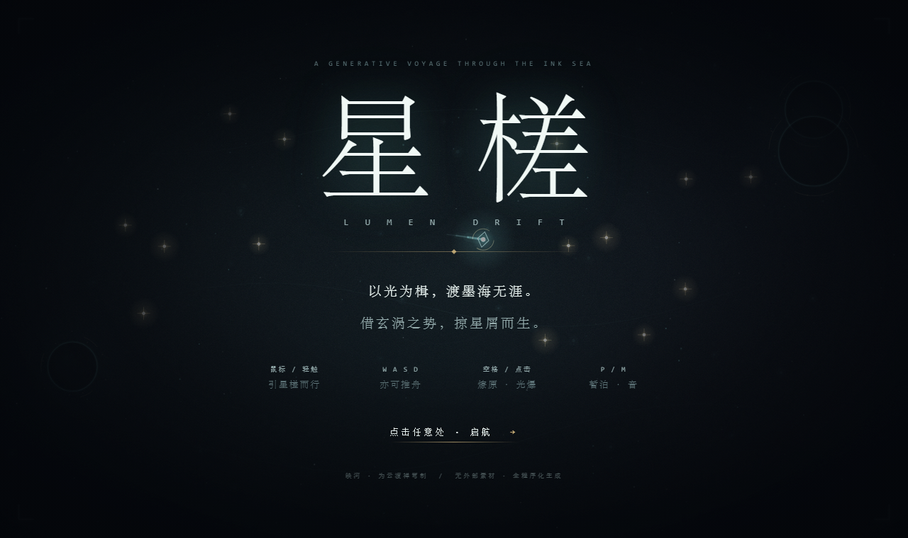
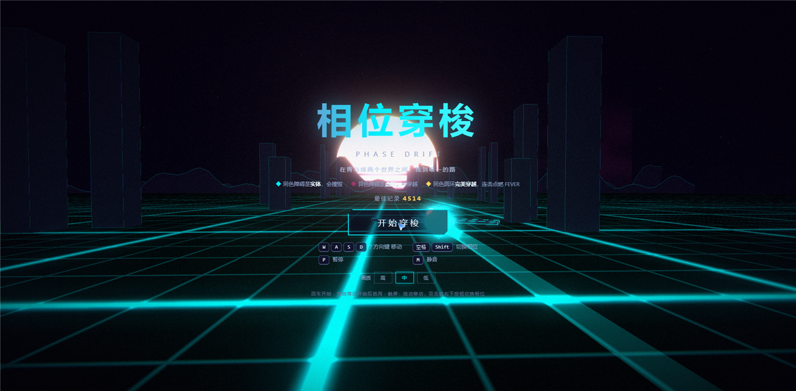
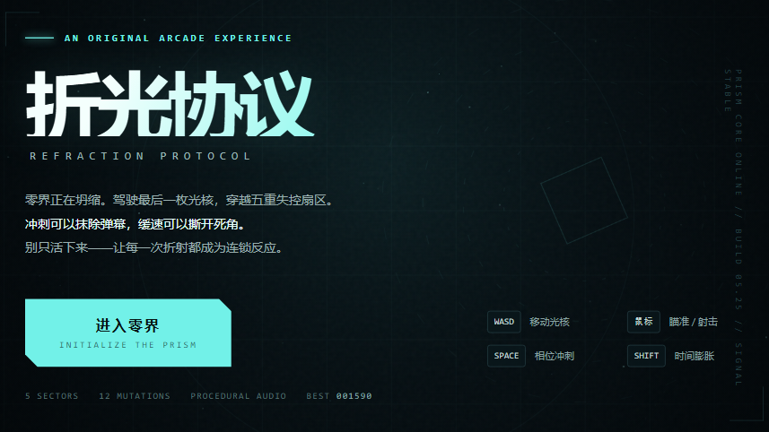

# 七款单文件网页游戏

一个仓库收录七款可直接在浏览器里玩的单文件小游戏。效仿 Fable 5.2 的做法：**画面、音乐、音效全部由代码生成**，不依赖任何图片、音频、字体等外部素材；每款游戏就是一个 `index.html`，双击即可离线游玩，也可通过下方链接在线点击即玩。

本仓库已开启 GitHub Pages 静态托管，所有链接均可直接打开。

## 关于本仓库

这是一组「单文件网页游戏」实验。2026 年 11 月，受 `fengyiqicoder/awesome-fable-5.2` 收录作品的启发——那批作品共同证明了一件事：**不需要图片、音频、字体和构建工具，仅靠浏览器里的代码，也能做出有电影感、能玩、有余韵的小作品**——于是照着这条路径，陆续做了七款。

七款作品共享同一条技术底线：

- **单文件**：每款就是一个 `index.html`，零外部素材、零 CDN、零依赖，双击即可离线打开；
- **全代码生成**：画面由 Canvas / WebGL 逐像素算出，音乐与音效由 Web Audio 实时合成，没有一行引用现成素材；
- **克制而完整**：各自有独立的命题、视觉语言与机制，标题页、操作提示、结算与静音/暂停一应俱全。

其中第六款《相位穿梭》将 Three.js r128 官方运行时内联进单文件，同样零联网、零外部素材；其余六款为纯原生 Canvas / WebGL。

七款刻意选了互不重复的画种与玩法，避免成为「又一个 3D demo」：

| 游戏 | 视觉语言 | 核心机制 |
|------|----------|----------|
| 传灯 | 夜色水墨 + 暖金光丝 | 实时光线追迹解谜 |
| 鹤渡 | 青绿山水 + 晨昏流转 | 御风飞行 / 穿门计分 |
| 星弦 | 深空放射法阵 + 七色极光 | 音乐节奏 / 七弦命中 |
| 星槎 | 墨海深空 + 引力光轨 | 引力弹弓 / 光爆清屏 |
| 落款 | 淡墨山水长卷 | 限墨续画 / 五卷成卷 |
| 相位穿梭 | 合成波霓虹 + 双相位色界 | 相位极性切换 / 环穿连击 |
| 折光协议 | 深空霓虹 + 几何光轨 | 街机射击 / 冲刺穿弹 / 时间膨胀 |

## 游戏一览

| # | 游戏 | 一句话 | 玩法 | 在线试玩 |
|---|------|--------|------|----------|
| 1 | 传灯 · THE PASSING LAMP | 一灯传一灯，七层塔次第醒来 | 拖动铜镜引导光路，点亮灯芯，让水墨从黑暗中显形 | [点击即玩](https://yukhughkui.github.io/fable-games/passing-lamp/) |
| 2 | 鹤渡 · AZURE CRANE | 御风而行，过千山而不留痕 | 点击振翅穿过石门、收集灵气，在晨昏流转的青绿山水间飞行 | [点击即玩](https://yukhughkui.github.io/fable-games/azure-crane/) |
| 3 | 星弦 · ASTRAL CHORD | 七弦张于星海，拨之令其开花 | 用 A S D F J K L 或点击拨动七弦，在星子滑到共鸣环时命中 | [点击即玩](https://yukhughkui.github.io/fable-games/astral-chord/) |
| 4 | 星槎 · LUMEN DRIFT | 以光为桨，渡墨海无涯 | 引舟借玄涡引力甩速，拾光蓄能放冲击波，在星潮中穿行 | [点击即玩](https://yukhughkui.github.io/fable-games/lumen-drift/) |
| 5 | 落款 · 一卷未完成的山水 | 你是那滴赶在淡墨之前落笔的墨 | 用有限的墨量续写脚下山径，走完五卷并为长卷落下印章 | [点击即玩](https://yukhughkui.github.io/fable-games/luokuan/) |
| 6 | 相位穿梭 · PHASE DRIFT | 在青与绯两个世界之间，找到唯一的路 | 同色障碍为实、异色为虚，空格切换相位；同色圆环完美穿越攒连击，点燃 FEVER ×2 | [点击即玩](https://yukhughkui.github.io/fable-games/phase-drift/) |
| 7 | 折光协议 · REFRACTION PROTOCOL | 让每一次折射，都成为连锁反应 | 驾驶光核穿越五重敌潮，以冲刺抹除弹幕、时间膨胀撕开死角，构筑独特光核并击碎三阶段 Boss | [点击即玩](https://yukhughkui.github.io/fable-games/refraction-protocol/) |

## 开始页面

每款游戏的开始页面（标题页）如下，点击进入即为游戏本体：

### 1. 传灯 · THE PASSING LAMP



实时光线追迹 + 东方夜色水墨。七层高塔沉睡于黑暗，拖动铜镜把一束光引向灯芯，被光照到的那一层，水墨才从黑暗中显形，并浮现一句诗。所有镜面角度由光路反推生成，保证每层有解；音效由 Web Audio 合成。

- 入口：[passing-lamp/index.html](passing-lamp/index.html) · [在线试玩](https://yukhughkui.github.io/fable-games/passing-lamp/)
- 操作：拖动鼠标 / 触屏旋转铜镜，蓄光点亮灯芯

### 2. 鹤渡 · AZURE CRANE


青绿山水御风飞行。晨、昼、暮、夜循环调色，四层远山视差，一只丹顶鹤穿过石门、收集灵气。难度随距离递增，带最高分记录与静音开关。

- 入口：[azure-crane/index.html](azure-crane/index.html) · [在线试玩](https://yukhughkui.github.io/fable-games/azure-crane/)
- 操作：点击 / 空格振翅，`P` 暂停

### 3. 星弦 · ASTRAL CHORD


深空紫黑底 + 七色极光放射星弦。七根弦张于星海，星子沿弦滑向共鸣环，在恰当时机拨弦命中。六个乐章 BPM 84→132，含连击、和谐度、评级结算与天籁满能全屏绽放。

- 入口：[astral-chord/index.html](astral-chord/index.html) · [在线试玩](https://yukhughkui.github.io/fable-games/astral-chord/)
- 操作：`A S D F J K L` 或点击拨弦，精确判定 PERFECT / GOOD

### 4. 星槎 · LUMEN DRIFT



墨海深空 + 引力弹弓光轨。驾驶一叶星槎借玄涡的引力甩速，拾取星屑蓄「燎原」，满能释放冲击波横扫玄涡墨鸦。逐潮演进的配色与难度，带连击加成与最高分。

- 入口：[lumen-drift/index.html](lumen-drift/index.html) · [在线试玩](https://yukhughkui.github.io/fable-games/lumen-drift/)
- 操作：鼠标 / 触屏 / `WASD` 引舟，空格 / 点击放光爆，`P` 暂停，`M` 静音

### 5. 落款 · 一卷未完成的山水


程序化生成的淡墨水卷。你是一滴墨，赶在淡墨底稿漫过之前用毛笔续写脚下的山径；墨量有限，写下的笔迹永久留在画上。走完溪、石、风、雾、归五卷，终章自动回放并落下「落款」朱印，还可将长卷导出为图片。

- 入口：[luokuan/index.html](luokuan/index.html) · [在线试玩](https://yukhughkui.github.io/fable-games/luokuan/)
- 操作：按住拖动绘制山径，拾取墨点补充墨量，`M` 静音

### 6. 相位穿梭 · PHASE DRIFT



合成波霓虹 3D 飞行。世界分青 / 绯两相：同色障碍是实体、异色障碍是虚影，空格瞬间切换整个世界的色相；同色圆环完美穿越累积连击，8 连击点燃 FEVER ×2，擦身而过另有奖励。Three.js WebGL 渲染 + Bloom / 色差 / 扫描线 / 故障艺术后处理，配乐由 Web Audio 实时合成并随相位与 FEVER 变化；三档画质与帧率自动降级，最佳纪录本地存档。本作由豆包（Doubao）生成。

- 入口：[phase-drift/index.html](phase-drift/index.html) · [在线试玩](https://yukhughkui.github.io/fable-games/phase-drift/)
- 操作：`WASD` / 方向键移动，空格 / `Shift` / 左键切换相位，`P` 暂停，`M` 静音，`R` 重开

### 7. 折光协议 · REFRACTION PROTOCOL



深空霓虹几何街机射击。驾驶最后一枚光核穿越五重失控扇区，面对四种敌人与三阶段「虚空构筑者」。相位冲刺可消除弹幕并反伤敌人，时间膨胀可消耗通量换取反应空间；拾取光屑解锁三选一变异，以 12 种升级构筑独特光核。画面由原生 Canvas 绘制，音乐与音效由 Web Audio 实时合成，支持键鼠、触屏、暂停、静音与本地最高分。本作由豆包（Doubao）生成。

- 入口：[refraction-protocol/index.html](refraction-protocol/index.html) · [在线试玩](https://yukhughkui.github.io/fable-games/refraction-protocol/)
- 操作：`WASD` / 方向键移动，鼠标瞄准 / 左键射击，`Space` 相位冲刺，`Shift` / 右键时间膨胀，`P` 暂停，`M` 静音

## 目录结构

```
fable-games/
├── index.html              # 游戏总入口（导航页）
├── README.md
├── passing-lamp/index.html # 传灯
├── azure-crane/index.html  # 鹤渡
├── astral-chord/index.html # 星弦
├── lumen-drift/index.html  # 星槎
├── luokuan/index.html      # 落款
├── phase-drift/index.html  # 相位穿梭
├── refraction-protocol/index.html # 折光协议
└── screenshots/            # 各游戏开始页面截图
```

## 本地运行

每款游戏都是自包含的单文件，直接用浏览器打开对应 `index.html` 即可，无需安装依赖或联网。也可以在本仓库目录启动任意静态服务器，例如：

```bash
python -m http.server 8000
```

然后访问 `http://localhost:8000/` 进入导航页。

## 静态托管

通过 GitHub Pages 部署，仓库地址：`https://github.com/yukhughkui/fable-games`，站点地址：`https://yukhughkui.github.io/fable-games/`。

---

导演 / 渲染 / 作曲：云渡禅穹 · 2026
